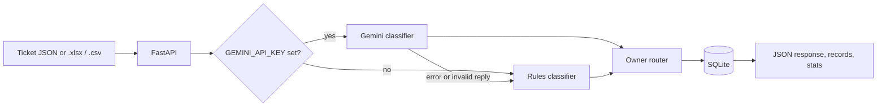

# AI Ticket Triage

[](https://github.com/jedi-ani/ai-ticket-triage/actions/workflows/ci.yml)


A containerised **FastAPI** service that turns a pile of support tickets into structured triage records. For every ticket it decides the **category** and **priority**, suggests which **engineering team and owner** should pick it up, and stores the result so it can be queried later.

It uses **Gemini** for classification and a deterministic **rules engine as a safety net**, so a quota error, timeout or malformed model reply never loses a ticket.

## Features

- **Single ticket or whole spreadsheet:** `POST` one ticket as JSON, or upload an `.xlsx` / `.csv` and triage hundreds at once.
- **Category and priority:** 9 categories (bug, billing, account access, security, ...) and 4 priority levels (P1 to P4).
- **Routing:** maps each result to a suggested team and owner from an editable JSON file; P1 tickets are flagged `escalate` and routed to incident response.
- **Resilient by design:** if Gemini fails, times out or returns something invalid, the rules classifier answers instead and the record says why (`fallback_reason`).
- **Safe with untrusted text:** ticket content is delimited and treated as data, and the model's reply is validated against strict enums.
- **Documented API:** interactive OpenAPI docs at `/docs`.
- **Tested:** unit tests for the classifiers, fallback, routing, storage and batch handling, plus API tests; CI runs them on every push.

## How it works



### Categories and priorities

| Priority | Meaning |
|---|---|
| **P1** | Critical: outage, data loss or active security incident affecting many users |
| **P2** | High: a major function is broken or users are blocked with no workaround |
| **P3** | Medium: degraded experience, a workaround exists |
| **P4** | Low: question, cosmetic issue or feature request |

Categories: `bug`, `feature_request`, `billing`, `account_access`, `performance`, `security`, `data_issue`, `how_to`, `other`.

## Quick start

### With Docker

```bash
git clone https://github.com/jedi-ani/ai-ticket-triage.git
cd ai-ticket-triage
cp .env.example .env          # optional: add GEMINI_API_KEY; without it the rules classifier is used
docker compose up --build
```

### Without Docker

```bash
git clone https://github.com/jedi-ani/ai-ticket-triage.git
cd ai-ticket-triage
python -m venv .venv && source .venv/bin/activate
pip install -r requirements.txt
cp .env.example .env          # optional: add GEMINI_API_KEY
uvicorn app.main:create_app --factory --reload
```

Open <http://localhost:8000/docs> for the interactive API documentation.

## Usage

Triage one ticket:

```bash
curl -s -X POST http://localhost:8000/tickets/triage \
  -H "Content-Type: application/json" \
  -d '{
        "ticket_id": "TCK-1042",
        "subject": "Checkout page down for all users",
        "description": "Customers get a 503 error on checkout since 09:10 UTC. This is an outage."
      }'
```

```json
{
  "category": "bug",
  "priority": "P1",
  "confidence": 0.6,
  "rationale": "matched keywords: error; critical wording: outage, all users",
  "source": "rules",
  "fallback_reason": null,
  "suggested_team": "Incident Response",
  "suggested_owner": "oncall-engineer",
  "escalate": true,
  "id": 1,
  "ticket_id": "TCK-1042",
  "subject": "Checkout page down for all users",
  "description": "Customers get a 503 error on checkout since 09:10 UTC. This is an outage.",
  "reporter": null,
  "created_at": "2026-11-22T11:06:54.675127Z"
}
```

(This example was produced by the rules classifier. With a Gemini key the shape is identical and `source` is `"gemini"`.)

Triage a spreadsheet. It needs `subject` and `description` columns; `ticket_id` and `reporter` are optional and other columns are ignored:

```bash
curl -s -X POST http://localhost:8000/tickets/batch \
  -F "file=@data/sample_tickets_200.xlsx"
```

### Endpoints

| Method | Path | Purpose |
|---|---|---|
| `POST` | `/tickets/triage` | Triage one ticket |
| `POST` | `/tickets/batch` | Triage an uploaded `.xlsx` / `.csv` |
| `GET` | `/tickets` | List records (`limit`, `offset`, `category`, `priority`) |
| `GET` | `/tickets/{id}` | Get one record |
| `GET` | `/stats` | Counts by category, priority and classifier |
| `GET` | `/health` | Liveness check |

## Configuration

Settings come from environment variables or a `.env` file (real environment variables win).

| Variable | Default | Description |
|---|---|---|
| `CLASSIFIER` | `auto` | `auto` uses Gemini when a key is set, otherwise rules; `gemini` requires a key; `rules` never calls an LLM |
| `GEMINI_API_KEY` | empty | Gemini API key (`GOOGLE_API_KEY` also works) |
| `GEMINI_MODEL` | `gemini-3.8-flash` | Model name. Gemini model names change over time, so override this if it is retired |
| `LLM_TIMEOUT_SECONDS` | `20` | Per-ticket timeout before falling back to rules |
| `DATABASE_PATH` | `data/triage.db` | SQLite file |
| `OWNERS_FILE` | `data/owners.json` | Team and owner routing table |
| `BATCH_CONCURRENCY` | `1` | Parallel LLM calls per batch. `1` is sequential and easiest on rate limits |
| `MAX_BATCH_ROWS` | `1000` | Row limit per upload |
| `MAX_UPLOAD_MB` | `5` | Upload size limit |

### Routing

`data/owners.json` maps each category to a team and owner, with a default and an optional override for P1 tickets. Edit it to match your organisation. The names in the repository are placeholders.

## Batch benchmark

`scripts/generate_sample_tickets.py` writes a reproducible set of synthetic tickets, and `scripts/benchmark.py` times a full batch end to end:

```bash
python -m scripts.generate_sample_tickets --count 200 --out data/sample_tickets_200.xlsx
python -m scripts.benchmark data/sample_tickets_200.xlsx --out results.xlsx
```

- Reference run: a 200-ticket synthetic spreadsheet was categorised in about **2 min 30 s** with Gemini, processing tickets sequentially (roughly 0.75 s per ticket). Timing depends on the model, network and rate limits.
- Rules-only mode finishes the same file in well under a second.
- The synthetic tickets carry the labels the generator intended, so the script also prints agreement with them. This is a smoke test, not an accuracy benchmark; the data is invented and written by the same author as the rules.

## Testing

```bash
pip install -r requirements-dev.txt
pytest -q
```

The classifier, fallback, routing, storage, configuration and batch tests run with the standard library plus `pydantic` and `openpyxl`. The API tests need FastAPI and `httpx` and are skipped if they are not installed. No test calls the real Gemini API; the model call is injected, so the suite runs offline.

## Design decisions

- **LLM first, rules as a safety net.** Language models are good at nuance but can fail or drift. A small, explainable keyword classifier keeps the service answering and gives every result a rationale.
- **Ticket text is untrusted.** It is wrapped in delimiters, delimiter look-alikes are stripped, the model is told not to follow instructions inside it, and the reply must match the enum values or it is discarded.
- **Logs avoid ticket content.** Failures log the error type, not the text of the ticket.
- **SQLite for storage.** It needs no extra service, which keeps the project easy to run. The repository class is the only place that touches the database.
- **Sequential batches by default.** Predictable timing and gentle on API quotas. Raise `BATCH_CONCURRENCY` to trade that for speed.

## Limitations

- There is **no authentication**. Run it behind an API gateway or add auth before exposing it.
- The rules classifier matches keywords, so it can be fooled by product names (for example a "billing portal" outage may be labelled billing). That is what the LLM is for.
- Classification quality with Gemini has not been measured against a labelled real-world dataset.
- SQLite suits a single node and moderate volume.

## Roadmap

- API-key authentication
- PostgreSQL option
- A labelled evaluation set and accuracy report
- Feedback endpoint so humans can correct a triage result

## Project structure

```
app/
  main.py             FastAPI app and endpoints
  service.py          LLM first, rules fallback, owner routing
  classifier/         base types, Gemini classifier, rules classifier
  owners.py           team and owner routing
  storage.py          SQLite repository
  batch.py            .xlsx / .csv parsing and batch runner
  config.py           environment settings
  schemas.py          Pydantic models
data/                 routing table and a 200-ticket synthetic sample
scripts/              sample generator and benchmark
tests/                unit and API tests
```

## Author

Built by [Anirban Dey](https://github.com/jedi-ani).

## License

MIT, see [LICENSE](LICENSE).
